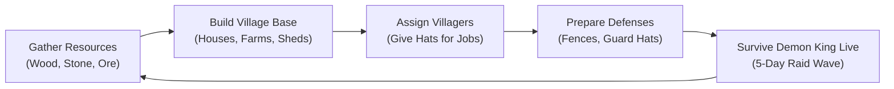

import Callout from '@framework/components/Callout.astro';

Welcome to the beginner and progression guide for **Warota: I Live Next to The Demon King's Castle LOL**. Following its Early Access launch on **13 November 2026**, players can experience all core systems through the **Platina Chapter**. Detailed construction notes are on [Village](/village), hat mechanics on [Hats](/hats), and combat raid tips on [Demon King](/demon-king).

## Game Overview & System Specifications

The game is developed by Team EARTHWARS and published by One or Eight. The table below summarizes release specifications and platform parameters verified on Steam:

| Fact | Steam / Official Status (13 Nov 2026 Early Access) |
| --- | --- |
| **Release Status** | Launched into Steam Early Access on **13 November 2026** (`coming_soon: false`). |
| **Playable Scope** | Full main storyline and systems through the **Platina Chapter**. |
| **Developer** | One or Eight and Team EARTHWARS (listed as Team EARTH WARS on English official site). |
| **Publisher** | One or Eight (ONE OR EIGHT INC.). |
| **Platforms** | Windows PC (Steam AppID 2860490). Console ports planned for 2027. |
| **Genres** | Action RPG, Village-Building, Tower Defense, Indie. |
| **Players** | Single-player with Steam Achievements, Steam Cloud, and Family Sharing enabled. |
| **Minimum Specs** | Windows 10/11 (64-bit), Intel Core i5-9400, 8 GB RAM, NVIDIA GeForce GTX 1050 Ti 4GB, DirectX 11. |
| **Languages** | English, Simplified Chinese, Traditional Chinese, Japanese (full audio in Japanese only). |
| **Demo** | Steam Demo AppID 5214670 released 7 Oct 2026; save data transfers to Early Access. |

## The Core Gameplay Loop in Luna

The game begins when you collapse at your desk and are reincarnated by a goddess into the ruined world of **Luna** as a **Bounder**. You wake up right next door to the Demon King's castle.

The game cycles through five interconnected activities:
1. **Resource Gathering**: Forage timber, mine minerals, and explore neighboring zones like Nebel Forest.
2. **Settlement Construction**: Repair your home, erect houses for newcomers, and build production workshops.
3. **Villager Delegation**: Give hats to arriving villagers to automate farming, logging, cooking, and guarding.
4. **Goddess Statues**: Pray at shrines to stack passive combat blessings (attack power, health recovery, elemental attributes).
5. **Concert Defense**: Repel hordes of hyped-up monsters triggered every 5 days by the Idol Demon King Platina's concerts.

## Early Game Village Progression Guide

To build a thriving settlement in the Platina Chapter without losing structures during the initial concerts, follow these proven progression milestones:

| Phase | Priority Objective | Key Actions & In-Game Mechanics | Status |
| --- | --- | --- | --- |
| **Phase 1: Shelter** | Repair Dilapidated House | Collect initial timber and stones to patch your starting residence and establish the village center. | Verified |
| **Phase 2: Food & Fiber** | Build Farm Shed (農作業小屋) | Place tilled plots; plant crops for food and gather wild **Manaleaf (マナリーフ)** in Nebel Forest to produce seeds for hat crafting. | Verified |
| **Phase 3: Logistics** | Place Storage Boxes (収納箱) | Build central chests; villagers automatically store harvested crops and timber and retrieve meals. | Verified |
| **Phase 4: Population** | Construct Houses & Assign Hats | Build separate homes to trigger new villager arrivals; hand them Farmer, Lumberjack, or Chef hats to automate labor. | Verified |
| **Phase 5: Vertical Growth** | Complete Carpenter's Trial 1 | Fulfill **大工の試練・1** to unlock vertical construction, allowing houses to be stacked up to **4 stories high**. | Verified |
| **Phase 6: Defense** | Funnel with Fences | Erect wooden and iron fencing (柵・鉄の柵) around farms; hand Guard hats to villagers before the Day 5 concert. | Verified |
| **Phase 7: Boss Battle** | Defeat Demon King Platina | Slay Platina to halt recurring 5-day concert raids and unlock peaceful town building. | Verified |
| **Late-Game Blueprints** | Tier 3+ building blueprints | Advanced structures outside the Platina Chapter. | 未核实 (Unverified) |

## Four Integrated Systems

The Early Access experience integrates four primary systems:

### 1. Village Building & Housing
Building goes beyond cosmetics: constructing functional facilities attracts villagers, while housing accommodates them. Completing Carpenter's Trial 1 enables 4-story stacking to maximize usable land. Details are on [Village](/village).

### 2. The Hat Job System
Hats channel divine power. Equipping a hat changes your Job Class, offering over 20 classes across development. You can also place hats on villagers to assign automated duties:
- **Farmer**: Automates soil tilling, planting, and harvesting into storage boxes.
- **Lumberjack**: Gathers wood from nearby groves.
- **Chef**: Cooks food at the cooking station (e.g., Weed Stew / 雑草鍋 in early game).
- **Guard / Warrior**: Mounts perimeter defense during monster raids and joins quests.
Details are on [Hats](/hats).

### 3. Blessings from Goddess Statues
Offering prayers to Goddess Statues scattered across Luna grants stackable blessings. Documented buff categories include:
- Boosting attack power
- Accelerating health recovery
- Granting elemental attributes

<Callout kind="note" title="No Exact Blessing Percentage Tables">
While statue locations and buff categories are active in the client, specific numerical percentage boosts and stack caps have not been published by the developers. Any unconfirmed numerical tables remain **未核实 (Unverified)**.
</Callout>

### 4. Demon King Live Concert Raids
Every 5 in-game days, the neighboring Idol Demon King Platina holds a raucous concert, sending crazed monsters stampeding toward your village. Players combine physical barriers (fences), Guard villagers, and active combat abilities to defend the settlement. Slaying Platina permanently stops the 5-day raid cycle. Details are on [Demon King](/demon-king).

## Early Access Scope & Development Roadmap

According to the developer notes for the 13 November 2026 launch:
- **Duration**: Early Access is slated to run for approximately one year, targeting an official 1.0 release in 2027 alongside console editions (PlayStation 5 and Nintendo Switch 2).
- **Content Scope**: The Platina Chapter is fully playable, covering the first complete story arc and roughly 25% of the planned total content.
- **Feedback & Updates**: Ongoing balance adjustments, control refinements, and additional construction blueprints will roll out through Steam patches.

<Callout kind="warn" title="What Remains Unverified">
Specific item crafting quantities, exact wave monster counts, full drop rate tables, and redeem codes are not documented in official releases. To keep this guide factual, all such unconfirmed details are marked **未核实 (Unverified)**.
</Callout>